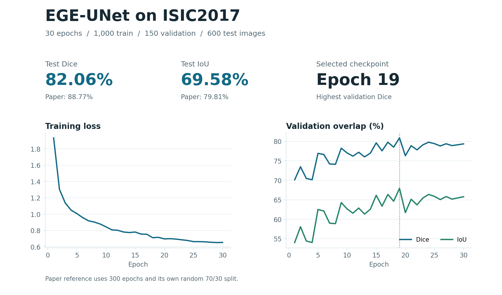
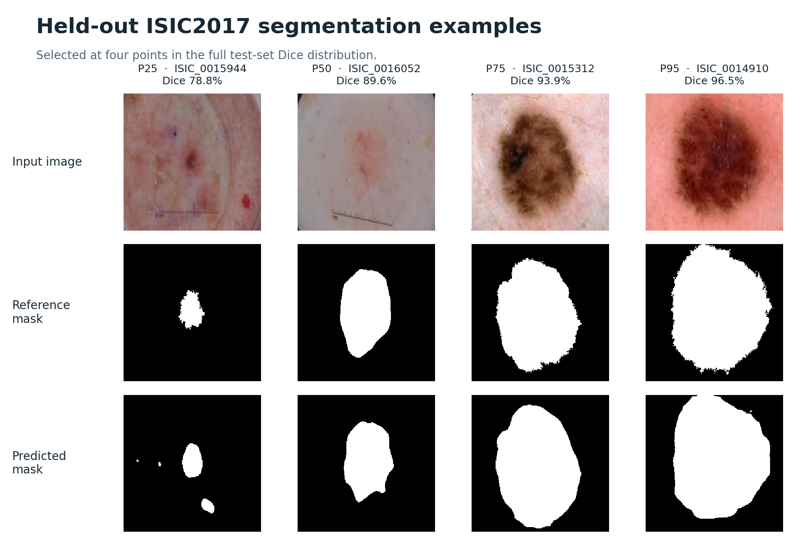

# 低算力下的皮膚病灶分割：EGE-UNet 短訓復現與離線證據核查

缪隽宇 · D26092110049  
數據科學前沿分析研究 · AT4 期末整合報告

## 摘要

本研究評估輕量分割模型 EGE-UNet 在有限訓練預算下的表現，並以離線 Agent 整理復現證據。在 ISIC2017 官方訓練集抽取 1,000 張影像訓練 30 輪，以 150 張驗證圖選擇權重，並在 600 張官方測試圖上評估。模型共有 53,374 個參數，測試 Dice 為 **82.06%**，前景 IoU 為 **69.58%**，逐圖 Dice 中位數為 **89.54%**。在 6 步工具預算下，本地規則式 Agent 以 5 次呼叫整合原論文、文獻對照與實測紀錄，生成附 3 條行號引用的簡報，並通過全部五項驗證。

本研究的分割復現原始碼公開於 [https://github.com/VincentCole02/Phd-course](https://github.com/VincentCole02/Phd-course)。

**關鍵詞**　皮膚鏡影像、輕量分割、EGE-UNet、技術復現、離線 Agent

## 1　緒論

皮膚鏡病灶分割在影像中標出病灶範圍，可為後續形態量測或影像分析提供輸入。ISIC2017 將分割、特徵偵測及疾病分類列為各自的任務 [1]。本文只評估病灶遮罩的重疊程度。對資源有限的環境，模型體積、輸入解析度和計算量會影響實作成本。EGE-UNet 的論文報告 0.053M 參數與 0.072 GFLOPs，並提供公開程式 [2]，適合檢查低預算下能重現哪些結果。

原文以隨機切分及 300 輪訓練建立參照。課程實驗在官方切分上採用一次短訓，能檢查資料、架構、訓練與推論流程，也留下逐圖結果供後續分析。機器學習復現研究強調記錄程式、資料及實驗條件 [3]。本文將原文設定、短訓設定和指標分開記錄，使讀者可以查明分數來自哪一套實驗。

本文回答兩個問題。**RQ1** 在既定的資料和訓練預算下，EGE-UNet 在官方測試集上取得什麼分割表現？**RQ2** 在固定來源與工具介面下，Agent 如何產出可追溯且通過驗證的證據簡報？

<!-- pagebreak -->

## 2　相關研究

### 2.1　輕量架構如何保留病灶細節

U-Net 的跳躍連接把高解析度的編碼特徵送回解碼端，補足下採樣流失的定位資訊，其原始實驗涵蓋顯微影像 [4]。MobileNetV2 以深度可分離卷積、倒殘差及線性瓶頸降低運算，提供移動端語義分割的設計參照 [5]。沿用 U 形結構的 UNeXt 把帶空間位移的 MLP 放在低解析度層，讓較昂貴的特徵混合在較小的空間網格上執行 [6]。MALUNet 將不同注意力模組置於編碼與跳躍連接，以擴張卷積及跨尺度注意力融合特徵 [7]。這些工作以不同方式限制特徵提取與融合的開銷。

**表 1　代表性模型的論文結果與比較條件**

| 模型 | 核心設計 | 參數量／GFLOPs | 原文分割結果 |
|:--|:--|:--|:--|
| UNeXt [6] | 低解析度空間位移 MLP | 1.47M／0.57 | ISIC2018，隨機切分，IoU 81.70%，F1 89.70% |
| EGE-UNet [2] | 分組多軸注意力、中間遮罩引導融合 | 0.053M／0.072 | ISIC2017，隨機切分，前景 IoU 79.81%，Dice 88.77% |
| LB-UNet [8] | 分組重排注意力、區域與邊界監督 | 0.038M／0.098 | ISIC2017，隨機切分，mIoU 80.13%，Dice 88.86% |
| TinyU-Net [9] | 部分通道的級聯多感受野卷積 | 0.48M／3.33 | ISIC2018，官方切分，病灶 IoU 80.04%，Dice 88.91% |

LB-UNet 以區域與邊界預測補充跳躍連接。按原文表格，其參數較 EGE-UNet 少約 28%，運算量約高 36%。模型大小和計算成本因而應同時報告。TinyU-Net 同時提供病灶 IoU 80.04% 與包含背景的平均 IoU 85.49%。同一模型僅改變類別聚合口徑，數字便相差 5.45 個百分點。表 1 保留各篇論文的資料版本、切分與指標，供定位設計取捨。

### 2.2　比較的單位與證據來源

像素池化會讓前景像素多的案例對總分有較大影響，逐圖平均則讓每張圖權重相同。影像分析指標的選擇應對應任務和錯誤類型 [10]。因此，本文用池化分數對照 EGE-UNet，另用逐圖統計、面積分層及遮罩示例呈現分割表現。

工具型 Agent 的行動與觀察紀錄提供另一種檢查途徑。ReAct 展示了以工具觀察更新後續行動的語言模型流程 [11]。本文採用固定規則和離線來源包，觀察呼叫序列及產物狀態。引用定位到工具實際回傳的行號，讓讀者能從簡報回查到指標檔和原文摘錄。

<!-- pagebreak -->

## 3　方法

### 3.1　EGE-UNet 與資料

本實驗沿用作者程式的網路，固定上游版本 `f52ba30c`。模型以逐層下採樣建立多尺度特徵。分組多軸 Hadamard 乘積注意力（GHPA）將通道分為四組。前三組在空間平面及含通道的兩個平面上，分別以可學習權重作逐元素乘積，第四組採用卷積處理。分組聚合橋（GAB）先投影及對齊深層特徵，再將相應的深、淺層通道與解碼器的中間遮罩合併。各組以不同擴張率的深度卷積處理，再做通道融合。中間預測因此能在解碼過程中參與特徵聚合 [2]。

資料取自 ISIC2017 Task 1 [1]。在官方 2,000 張訓練圖內，以固定亂數種子 42 抽取 1,000 張，三個集合的影像 ID 互斥。驗證集 150 張、測試集 600 張，均採用官方切分的全部影像。使用公開縮圖及官方二值遮罩，將 RGB 影像雙線性縮放到 256 × 256，標註用最近鄰縮放。像素值除以 255。僅訓練資料對影像與遮罩同步施加隨機水平翻轉、垂直翻轉及 90° 倍數旋轉。

### 3.2　訓練、選模與評估

模型從零開始訓練。主要輸出以二元交叉熵加 Dice loss 作為損失，五個輔助遮罩依程式輸出順序加權 0.1、0.2、0.3、0.4 和 0.5。優化器採 AdamW [12]，初始學習率 0.001，權重衰減 0.01，餘弦退火最低學習率 0.00001。批次大小 8，訓練 30 輪，軟硬體為 Python 3.11.10、PyTorch 2.5.0、CUDA 12.1 和 RTX 4060 Laptop GPU。每輪評估驗證集，以池化前景 Dice 最高的輪次保留權重。測試時使用固定的 0.5 二值化閾值。

TP、FP 和 FN 分別表示正確標出的病灶像素、錯標為病灶的背景像素及漏標的病灶像素。先在整個集合分別加總三項計數，再計算 Dice = 2TP／(2TP + FP + FN) 與前景 IoU = TP／(TP + FP + FN)。本文也對每張圖單獨計算 Dice，報告平均數、中位數及四分位數。論文表 1 所稱的 mIoU 在上游程式中採用同樣的前景公式。[上游評估程式](https://github.com/JCruan519/EGE-UNet/blob/f52ba30c6bf7d0ca479c2c9d4a3cbda999f49d3a/engine.py)

本文以 600 張逐圖計數做 5,000 次影像層級的有放回抽樣，種子為 42。每次將抽到的影像計數加總後重算 Dice 與 IoU，取第 2.5 和 97.5 百分位。區間反映固定權重下對本測試集影像重抽樣的變動。另按縮放後標註的前景面積排序，每 150 張分一組，比較不同面積組的逐圖 Dice。

<!-- pagebreak -->

### 3.3　離線 Agent、受控比較與驗證

Agent 的任務是回答「EGE-UNet 為何適合低算力復現，以及短訓與原文相差多少」。來源包包含 S01 原論文設定與結果、S02 課程文獻對照、S03 短訓原始指標及 S04 顯微影像背景資料。兩組共用同一任務合約、查詢詞、檢索排序、來源內容、工具與驗證器。比較只調整 `max_steps`，每次工具呼叫占一步。正文展示 6 步預算下的完整流程，兩種預算的執行紀錄均隨實驗資料附存。

執行時先用 `search_catalog` 檢索來源，再按排序以 `read_source` 逐份讀取，達到三份來源後用 `write_brief` 寫出 Markdown 簡報。執行只用 Python 標準庫，讀取限制在本地來源包，寫入當次執行資料夾。規則以當前狀態決定下一次呼叫。日誌以組別和步號對應工具參數、回傳值和狀態轉移。

執行結束後，獨立的驗證器檢查磁碟產物及工具紀錄。五項條件為已寫出簡報、三條來源引用、引用行可在已讀觀察中定位、讀取三份來源、使用步數在預算內。另記錄篇幅、段落和引用格式。每組執行一次。保留兩組的 trajectory、tool results、validation，以及可追溯至輸入檔和產物雜湊的 provenance。

## 4　實驗結果

### 4.1　整體分割表現

第 19 輪的驗證 Dice 最高，為 80.89%，前景 IoU 為 67.92%。第 30 輪驗證 Dice 為 79.36%。訓練及逐輪驗證共耗時 239.74 秒。載入第 19 輪權重後，測試集計數為 TP 7,173,319、FP 1,026,608、FN 2,109,378，得到表 2 所示的池化分數。

**表 2　短訓測試結果與原論文的 ISIC2017 參考值**

| 指標 | 本研究 | 原文表 1，均值 ± 標準差 |
|:--|--:|--:|
| Dice | **82.06%** | 88.77 ± 0.06% |
| 前景 IoU | **69.58%** | 79.81 ± 0.10% |
| 參數量 | 53,374 | 約 53,000 |

本研究採用官方切分、公開縮圖及 30 輪訓練。原文將 2,150 張 ISIC2017 影像按 7∶3 隨機切分，訓練 300 輪，並報告五次實驗的均值與標準差 [2]。原文數值提供較長訓練設定下的參考。

本研究使用同一權重及資料清單另做 CPU 重評。Dice 和前景 IoU 保留兩位小數後與表 2 一致。兩個執行裝置的像素計數有小幅差異，原短訓的 CUDA 結果與逐圖計數用於下文分析。

<!-- pagebreak -->

### 4.2　訓練軌跡與逐圖分布

短訓的訓練損失從第 1 輪約 1.93 降到第 30 輪約 0.65。驗證分數初期上升，後續仍波動，因此以獨立驗證集而非最後輪次選模。固定權重下，像素池化 Dice 的影像 bootstrap 95% 區間為 **80.18%–83.83%**，前景 IoU 為 **66.92%–72.16%**。同一次訓練的重抽樣區間與原文跨五次訓練的標準差描述不同變異來源，應分別解讀。

逐圖 Dice 平均為 81.61%，中位數為 89.54%，第 25 至第 75 百分位為 78.77% 至 93.90%。池化分數按像素計數匯總，逐圖分布則以每張影像為單位，提供病例層級的表現資訊。

**表 3　按標註前景面積排序的逐圖 Dice（每組 150 張）**

| 前景面積分組 | 標註像素範圍 | 逐圖 Dice 平均 |
|:--|--:|--:|
| 第 1 四分位（最小） | 208–3,193 | 82.17% |
| 第 2 四分位 | 3,207–10,265 | 80.66% |
| 第 3 四分位 | 10,319–23,391 | 84.55% |
| 第 4 四分位（最大） | 23,635–62,395 | 79.07% |

各面積組的平均 Dice 介於 79.07% 至 84.55%，第三組最高。面積組按縮放後的標註像素數劃分，可用於比較不同影像覆蓋範圍的分割表現。

<!-- pagebreak -->

### 4.3　分割遮罩示例

四個示例的 Dice 約介於 78.8% 和 96.5%。接近中位數的 ISIC_0016052 保留了病灶的主要輪廓。ISIC_0015312 的預測覆蓋了標註病灶的大部分區域，ISIC_0014910 的預測輪廓與標註接近。示例用於直觀呈現不同重疊程度的遮罩，整體分數與分布均以 600 張測試影像計算。

<!-- pagebreak -->

### 4.4　完成證據簡報的工具流程

在 6 步預算下，Agent 以 5 次呼叫完成檢索、來源讀取與簡報寫入。表 4 列出各步的輸出，便於將簡報中的引用對回工具紀錄。

**表 4　通過驗證的 Agent 執行紀錄**

| 工具步驟 | 呼叫 | 輸出 |
|--:|:--|:--|
| 1 | 檢索來源目錄 | 找到 S03、S01、S02、S04 |
| 2 | 讀取 S03 | 短訓實測指標與設定 |
| 3 | 讀取 S01 | EGE-UNet 方法及原文實驗設定 |
| 4 | 讀取 S02 | 輕量分割模型的文獻對照 |
| 5 | 寫入簡報 | 附三條行號引用的 Markdown 簡報 |

簡報通過全部五項驗證。三條引用定位到 S01 第 1 至 2 行、S02 第 1 行及 S03 第 1 至 3 行。人工核對確認簡報中的 Dice、前景 IoU、第 19 輪權重及 0.5 二值化閾值均與實測紀錄一致。

## 5　討論

### 5.1　低預算下的復現效果

53,374 個參數的 EGE-UNet 在約四分鐘的訓練與驗證後，於官方測試集取得 82.06% Dice。第 19 輪權重經驗證集選出，CPU 重評也得到相同的兩位小數結果，形成從訓練紀錄到測試指標的完整核查流程。這一結果適用於本研究的官方切分、公開縮圖與 30 輪設定。原文與本研究採用不同的資料及訓練條件，因此兩者的分數差距應結合實驗設定理解。

### 5.2　影像層級的評估

逐圖 Dice 中位數為 89.54%。面積分層及遮罩示例有助於了解不同病灶覆蓋範圍下的表現。影像 bootstrap 區間描述固定權重下測試樣本組成的變動，多種子訓練與跨機構測試可進一步評估訓練穩定性及資料轉移。針對輪廓精度與裝置部署，可分別加入邊界指標、實測推論延遲及記憶體峰值。

### 5.3　證據整理流程與研究展望

在本研究的工具介面下，一次檢索、三次來源讀取及一次寫入構成五步工作流程。工具預算可依所需來源數及寫入步驟設定。引用行號與呼叫日誌讓讀者能逐項追溯簡報中的設定和數值。

後續實驗可沿兩個方向展開。分割部分固定資料切分及預處理，以多種子比較 30 與 300 輪訓練，並加入 1,000 與 2,000 張訓練資料的組合，分析資料量與訓練預算的關係。Agent 部分固定 6 步預算，改變查詢詞或加入無關來源，觀察檢索品質對來源覆蓋率和簡報驗證結果的影響。

<!-- pagebreak -->

## 6　結論

EGE-UNet 在 1,000 張訓練影像上訓練 30 輪後，於 600 張官方測試圖取得 Dice 82.06%、前景 IoU 69.58%，逐圖 Dice 中位數為 89.54%。同一權重在 CPU 重評後得到一致的兩位小數結果。離線 Agent 以 5 次工具呼叫完成附三條引用的證據簡報，並通過全部五項驗證。隨附的分割程式、模型權重、逐圖計數及工具紀錄可用於重跑與核查。

**程式與資料**　分割程式的既有版本為 [VincentCole02/Phd-course，提交 561bb39](https://github.com/VincentCole02/Phd-course/tree/561bb399265cceb003cbb2610a4e7565e8f5d11a)。AT4 配套目錄提供重跑指令、圖表、測試分析以及離線 Agent 工具與證據。影像來源見 [ISIC Challenge 2017 資料頁](https://challenge.isic-archive.com/data/#2017)，上游網路見 [EGE-UNet 官方程式](https://github.com/JCruan519/EGE-UNet/tree/f52ba30c6bf7d0ca479c2c9d4a3cbda999f49d3a)。

## 參考文獻

1. Codella NCF, et al. Skin Lesion Analysis Toward Melanoma Detection: A Challenge at the 2017 International Symposium on Biomedical Imaging (ISBI), Hosted by the International Skin Imaging Collaboration (ISIC). ISBI, 2018. [arXiv:1710.05006](https://arxiv.org/abs/1710.05006).
2. Ruan J, Xie M, Gao J, Liu T, Fu Y. EGE-UNet: an Efficient Group Enhanced UNet for skin lesion segmentation. MICCAI, 2023. [arXiv:2307.08473](https://arxiv.org/html/2307.08473v1).
3. Pineau J, et al. Improving Reproducibility in Machine Learning Research (A Report from the NeurIPS 2019 Reproducibility Program). JMLR, 2021, 22(164): 1–20. [JMLR](https://www.jmlr.org/papers/v22/20-303.html).
4. Ronneberger O, Fischer P, Brox T. U-Net: Convolutional Networks for Biomedical Image Segmentation. MICCAI, 2015. [arXiv:1505.04597](https://arxiv.org/abs/1505.04597).
5. Sandler M, Howard A, Zhu M, Zhmoginov A, Chen LC. MobileNetV2: Inverted Residuals and Linear Bottlenecks. CVPR, 2018. [CVF](https://openaccess.thecvf.com/content_cvpr_2018/html/Sandler_MobileNetV2_Inverted_Residuals_CVPR_2018_paper.html).
6. Valanarasu JMJ, Patel VM. UNeXt: MLP-based Rapid Medical Image Segmentation Network. MICCAI, 2022. [arXiv:2203.04967](https://arxiv.org/abs/2203.04967).
7. Ruan J, Xiang S, Xie M, Liu T, Fu Y. MALUNet: A Multi-Attention and Light-weight UNet for Skin Lesion Segmentation. IEEE BIBM, 2022. [arXiv:2211.01784](https://arxiv.org/abs/2211.01784).
8. Xu J, Tong L. LB-UNet: A Lightweight Boundary-assisted UNet for Skin Lesion Segmentation. MICCAI, 2024. [MICCAI Open Access](https://papers.miccai.org/miccai-2024/446-Paper2135.html).
9. Chen J, Chen R, Wang W, Cheng J, Zhang L, Chen L. TinyU-Net: Lighter yet Better U-Net with Cascaded Multi-Receptive Fields. MICCAI, 2024. [MICCAI Open Access](https://papers.miccai.org/miccai-2024/paper/2191_paper.pdf).
10. Maier-Hein L, et al. Metrics Reloaded: recommendations for image analysis validation. Nature Methods, 2024, 21: 195–212. [DOI](https://doi.org/10.1038/s41592-023-02151-z).
11. Yao S, et al. ReAct: Synergizing Reasoning and Acting in Language Models. ICLR, 2023. [arXiv:2210.03629](https://arxiv.org/abs/2210.03629).
12. Loshchilov I, Hutter F. Decoupled Weight Decay Regularization. ICLR, 2019. [arXiv:1711.05101](https://arxiv.org/abs/1711.05101).
